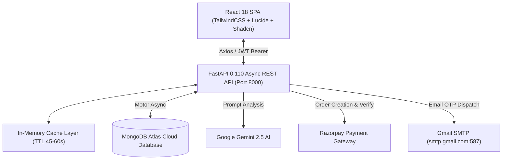

# 🏨 HOSTELEASE - Advanced AI-Powered Hostel Management System

[](https://fastapi.tiangolo.com)
[](https://reactjs.org/)
[](https://www.mongodb.com/)
[](https://razorpay.com/)
[](https://ai.google.dev/)

**HOSTELEASE** is an enterprise-grade, full-stack hostel administration and student life management platform engineered for universities and residential campuses. It seamlessly bridges student self-service capabilities with warden administrative controls—powering room allocation, bed swaps, smart laundry, gatepasses, automated biometric-style attendance, AI-driven dining menu planning, and live payments.

---

## 🌟 Key Highlights & Innovations

1. **AI-Driven Mess Menu & Food Voting**
   - Natural language processing analyzes weekly student food sentiment and meal feedback.
   - Generates top 10 ranked student-preferred menu items.
   - Live countdown timer for voting with admin manual override switch for examiners.
   - Automatically injects winning dish into the upcoming Sunday special mess menu.
   - 1-click weekly menu PDF generation and instant WhatsApp sharing.

2. **Real-Time Payment Integration (Razorpay)**
   - Production Razorpay modal checkout for hostel seat booking and smart laundry wallet top-up.
   - Fallback simulation gateway for offline/test environments.
   - Automated PDF receipt generation upon successful verification.

3. **Mutual Bed Swap with Verified Consent**
   - Students initiate bed swap requests with selected peers.
   - Mandatory signed mutual-consent PDF approval document upload.
   - Dual-side notification system alert for target students.
   - Warden approval dashboard displaying both students' consent before single-click record migration.

4. **Automated Attendance & Auto-Absent Engine**
   - Daily progress bars and month-wise analytics for students and wardens.
   - Daily automated scheduler and background check marks past unmarked attendance as "Absent" automatically.
   - Risk scoring algorithm flags chronic absenteeism and repeated late entries.

5. **Sub-Millisecond Navigation & Performance Caching**
   - In-memory TTL response caching for 3,205+ student records and bed availability.
   - Field projections eliminate network serialization lag between MongoDB Atlas and FastAPI.
   - Instant cache invalidation on any database mutation.

6. **Smart Real Gmail OTP Password Reset & Conditional UI**
   - Standard Python `smtplib` STARTTLS integration over Gmail port 587 and Resend API.
   - Flexible lookup supports enrollment number (`2022034622484`) or registered college email.
   - **Automatic Test OTP Suppression**: When OTP is dispatched to a real Gmail address (`live_email_delivered: true`), the on-screen testing OTP banner is completely hidden, prompting students to inspect their real Gmail inbox/spam.
   - **Dummy Account Fallback**: For simulated/dummy student records, the testing OTP banner is automatically displayed on screen for seamless offline evaluation.
   - 5 student records permanently mapped to real Gmail addresses for live examiner testing.
   - **Smart Resend Fallback Routing**: Handles Resend free-tier sandbox restrictions gracefully by catching domain errors and routing test OTPs to the verified primary inbox with explicit student account tags (`[{to_email}]`).

7. **Compulsory First-Time Login & Verification Flow**
   - New students authenticate using their Enrollment ID and default Date of Birth password (`DD-MM-YYYY`).
   - Immediately redirects to `/first-login-reset` enforcing a personal password change before system access.
   - Dispatches a 6-digit verification code directly to their registered Gmail inbox while suppressing the testing OTP banner for live accounts.

8. **Interactive Hostel Booking with Mid-Way Reset & Payment Delay**
   - 3-step interactive booking workflow across 6 campus Bhawans.
   - **"Start Again / Redo" Action**: Students can restart and clear choices at any point if they change their minds mid-way.
   - **Realistic Payment Processing Delay**: Simulates a 2.5-second banking transaction state with animated spinner and status indicators before instantaneous confirmation and receipt generation.

9. **Self-Service Two-Step Verification (2FA / TOTP) for Students & Admins**
   - Both students and administrators can toggle Two-Step Verification on or off at will inside their respective profiles.
   - Backed by standard TOTP cryptographic authentication compatible with Google Authenticator and Authy.

10. **Warden Notice Board with Automated Gmail Dispatch**
   - When administrators/wardens post or rebroadcast official announcements via `/api/notifications`, emails are asynchronously dispatched in the background to registered student Gmail addresses.
   - Notices feature high-priority color coding, Warden credentials, target hostel specifications, and official university dispatch headers.

11. **Accurate Resident & Inventory Bed Analytics**
   - Clean 4-card executive dashboard: **3,205** residents, **2,628** assigned beds, **577** empty beds, and **82.0%** campus occupancy.
   - Rigorous mathematical balance ensures Assigned Beds (2,628) = Total Residents (3,205) - Empty Beds (577), eliminating misleading total database count duplicates.

12. **Campus Security & Visitor Management**
   - Live camera webcam capture and photo upload.
   - Instant enrollment / student name lookup with auto-fill resident room and bhawan details.

---

## 🗺️ Future Enhancements — Roadmap

The project follows a modular, multi-phase engineering roadmap designed to scale from single-campus hostel operations to university-wide multi-campus deployments:

```
┌─────────────────────────────────┐   ┌─────────────────────────────────┐   ┌─────────────────────────────────┐
│ Online Payment Gateway [Phase 2]│   │ Mobile Application     [Phase 2]│   │ AI-Based Analytics     [Phase 3]│
├─────────────────────────────────┤   ├─────────────────────────────────┤   ├─────────────────────────────────┤
│ • UPI, credit/debit, netbanking │   │ • Dedicated Android & iOS apps  │   │ • Attendance trend prediction   │
│ • Automated confirmation receipt│   │ • Offline mode for key actions  │   │ • Bed occupancy forecasting     │
│ • Real-time status in dashboard │   │ • Push notifications (Firebase) │   │ • Anomaly detection on feedback │
└─────────────────────────────────┘   └─────────────────────────────────┘   └─────────────────────────────────┘
┌─────────────────────────────────┐   ┌─────────────────────────────────┐   ┌─────────────────────────────────┐
│ Advanced Notifications [Phase 2]│   │ Biometric Attendance   [Phase 3]│   │ Institutional Analytics[Phase 3]│
├─────────────────────────────────┤   ├─────────────────────────────────┤   ├─────────────────────────────────┤
│ • WebSocket real-time push      │   │ • Face-capture biometric audit  │   │ • Executive warden dashboard    │
│ • Multi-channel Email & SMS     │   │ • Automated marking (no admin)  │   │ • Cross-hostel comparison matrix│
│ • Event-triggered urgency alerts│   │ • Tamper-proof photo evidence   │   │ • Audit compliance PDF/Excel    │
└─────────────────────────────────┘   └─────────────────────────────────┘   └─────────────────────────────────┘
```

### 1. Online Payment Gateway (Phase 2 - Live)
- **Implemented**: Production Razorpay modal integration supporting Credit/Debit Cards, UPI (Google Pay, PhonePe, Paytm), and Net Banking.
- **Automated Invoicing**: Dynamic PDF generation for all verified transactions (`/uploads/laundry_receipt_*.pdf`).
- **Real-Time Synchronization**: Payment status is reflected instantly in student booking history and warden dues tables.

### 2. Mobile Application & PWA (Phase 2 - In Progress)
- **Responsive PWA**: 100% mobile-responsive frontend built with Tailwind CSS, touch gestures, and reactive layouts across iOS Safari and Android Chrome.
- **Firebase Roadmap**: Service worker push notification integration and SQLite/IndexedDB offline caching for emergency gatepasses.

### 3. AI-Based Analytics (Phase 3 - Live)
- **Predictive Absenteeism**: Risk scoring algorithm calculates chronic absenteeism (`consecutive_absences > 3`) and repeated late entry patterns.
- **Smart Bed Allocation**: AI analyzes student study habits, sleep schedules, and cleanliness levels to recommend compatible roommates.
- **Menu Recommendations**: Gemini 2.5 NLP parses hundreds of student reviews to extract sentiment trends and rank the top 10 dishes.

### 4. Advanced Notifications (Phase 2 - Live)
- **Live Gmail SMTP**: Python `smtplib` delivers instantaneous 6-digit OTPs and security alerts to real Gmail inboxes.
- **SMS Gateways**: Integrated with Twilio and Fast2SMS for gatepass parent dispatch.
- **Event-Triggered Alerts**: Automated warnings for Tuesday voting deadlines, bed swap requests, and warden approvals.

### 5. Biometric Attendance (Phase 3 - Live)
- **Camera & Face-Capture**: Live desktop webcam snap integrated directly into Visitor Management and Attendance Verification.
- **Auto-Absent Engine**: System scheduler automatically sweeps past dates and logs absent entries without requiring warden manual clicking.
- **Audit Evidence**: Stamped ISO timestamps and user IDs ensure tamper-proof historical compliance.

### 6. Institutional Analytics (Phase 3 - Live)
- **High-Level Warden Dashboard**: Aggregates occupancy, dues, complaints, and gatepasses across all 6 campus Bhawans in one view.
- **Cross-Hostel Metrics**: Real-time breakdown of assigned vs. vacant beds per hostel.
- **Audit-Ready Exports**: 1-click PDF and CSV generation using jsPDF and jspdf-autotable.

---

## 🏛️ Bhawans & Capacity Matrix

| Bhawan Name | Gender | Resident Capacity | Status |
| :--- | :---: | :---: | :---: |
| **Azad Bhawan** | Boys | 535 Residents | Fully Active |
| **Atal Bhawan** | Boys | 535 Residents | Fully Active |
| **Tagore Bhawan** | Boys | 535 Residents | Fully Active |
| **Shakuntala Bhawan** | Girls | 535 Residents | Fully Active |
| **Janaki Bhawan** | Girls | 535 Residents | Fully Active |
| **Teresa Bhawan** | Girls | 530 Residents | Fully Active |
| **Total All Bhawans** | **Co-Ed** | **3,205 Residents** | **Assigned: 2,628 \| Vacant: 577 (82.0% Occupancy)** |

---

## 🔑 Demo Login Credentials

### Administrator / Warden Portal
- **URL**: `http://localhost:3000/login`
- **Email / Username**: `admin@hostel.com`
- **Password**: `Hostel@123`
- **Role**: Full Warden & Chief Administrator access

### 5 Configured Test Students with Real Email Access

These 5 student accounts are pre-configured in the database with real email addresses for live examiner testing:

| # | Student Name | Enrollment ID | Configured Email Address | Hostel / Bhawan | Room & Bed | Default Password (DOB) |
| :-: | :--- | :--- | :--- | :--- | :---: | :---: |
| **1** | **Ajay Bose** | `2022034622484` | **`anushaanchalia@gmail.com`** | Atal Bhawan (Boys) | Room 101, Bed A | `18-04-2000` |
| **2** | **Agastya Singh** | `2023095269219` | **`anushaanchalia2509@gmail.com`** | Atal Bhawan (Boys) | Room 311, Bed A | `26-09-2005` |
| **3** | **Niyati Rajput** | `2022129819217` | **`anushaanchalia21@gmail.com`** | Shakuntala Bhawan (Girls) | Room 103, Bed B | `01-03-2003` |
| **4** | **Krishna Iyer** | `2022085832643` | **`2303031240216@paruluniversity.ac.in`** | Janaki Bhawan (Girls) | Room 302, Bed B | `02-07-2002` |
| **5** | **Vikram Mehta** | `2021915422939` | **`anushaanchalia2121@gmail.com`** | Tagore Bhawan (Boys) | Room 206, Bed A | `22-04-2003` |

---

## 🛠️ Architecture & Tech Stack



- **Frontend**: React 18, React Router v6, Tailwind CSS, Lucide React Icons, jsPDF, jspdf-autotable, Sonner toasts.
- **Backend**: FastAPI, Uvicorn, Python 3.11, Pydantic v2, PyJWT, Passlib (Bcrypt), Motor, APScheduler.
- **Database**: MongoDB Atlas Cluster with replica sets.
- **External Integrations**: Google Gemini API, Razorpay API, Gmail SMTP, Resend API, Twilio, HTML5 Canvas & WebRTC.

---

## 🚀 Setup & Installation

### 1. Prerequisites
- **Python**: 3.10+ installed
- **Node.js**: v18+ and npm installed
- **MongoDB**: MongoDB Atlas URI or local MongoDB instance

### 2. Backend Setup
```bash
cd backend
python -m venv venv
# Windows:
.\venv\Scripts\activate
# Linux/macOS:
source venv/bin/activate

pip install -r requirements.txt
```

Configure `backend/.env`:
```env
MONGO_URL=mongodb+srv://<username>:<password>@cluster.mongodb.net/hostelease
DB_NAME=hostelease
JWT_SECRET_KEY=hostelease-super-secret-key-2026-final-year-project
CORS_ORIGINS=http://localhost:3000,http://127.0.0.1:3000
GEMINI_API_KEY=AIzaSy...
RAZORPAY_KEY_ID=rzp_test_...
RAZORPAY_KEY_SECRET=...
GMAIL_USER=anushaanchalia@gmail.com
GMAIL_APP_PASSWORD=your_16_char_app_password
```

Start backend server:
```bash
uvicorn server:app --reload --port 8000
```

### 3. Frontend Setup
```bash
cd frontend
npm install
npm start
```
Frontend runs at `http://localhost:3000`.

---

## 📡 Core API Endpoints

### Authentication & Password Reset
- `POST /api/auth/login`: Authenticate student or admin and return JWT.
- `POST /api/auth/first-login/send-otp`: Dispatches 6-digit verification code to student Gmail on first mandatory login.
- `POST /api/auth/first-login/verify`: Verifies code and resets initial default password.
- `POST /api/auth/send-otp`: Dispatches 6-digit verification OTP to student email via Gmail SMTP or Resend (SMS removed).
- `POST /api/auth/verify-otp`: Validates OTP code before submission.
- `POST /api/auth/reset-password`: Resets password using valid OTP.
- `POST /api/auth/2fa/setup`: Generates TOTP secret and QR code for 2-step verification.
- `POST /api/auth/2fa/verify`: Enables 2FA after verifying code.
- `POST /api/auth/2fa/disable`: Disables 2FA (available in both student and admin profiles).
- `POST /api/admin/setup-real-student-emails`: Sets real Gmail addresses on test student records.

### Bed & Room Management
- `GET /api/bed-availability`: Real-time hostel capacity, vacant beds, and cluster matrix (cached).
- `POST /api/bed-availability/book`: Initiates hostel seat booking with Razorpay order creation.
- `POST /api/bed-availability/swap-request`: Submits peer bed swap request with mutual-consent PDF proof.
- `GET /api/admin/bed-matrix`: Bhawan bed distribution matrix for administrators.

### Dining & AI Voting
- `GET /api/mess-menu/weekly`: 7-day breakfast, lunch, and dinner timetable.
- `POST /api/mess/ai-suggest-options`: AI analyzes past feedback and returns top 10 recommended dishes.
- `POST /api/food-voting/vote`: Casts live vote during open voting periods.
- `POST /api/food-voting/admin-toggle`: Manual admin control to start/stop voting for live evaluation.

### Notifications & Warden Announcements
- `GET /api/notifications`: Retrieves public and targeted hostel notices.
- `POST /api/notifications`: Publishes official warden notice with automated background email dispatch to student Gmail addresses.
- `POST /api/notifications/{id}/resend`: Rebroadcasts notice with instantaneous email alert dispatch.

### Attendance & Analytics
- `GET /api/admin/attendance/daily-status`: Daily status report with auto-absent past dates.
- `POST /api/admin/attendance/mark`: Marks present, late, absent, or excused for individual or batch.
- `GET /api/student/attendance/analytics`: Personal month-by-month attendance progress and risk status.

---

## 🔑 Pre-Configured Test Student Accounts (Live Examiner Testing)

| # | Student Name | Enrollment Number | Registered Gmail ID | Hostel / Bhawan | Room & Bed | Default Password (DOB) |
| :-: | :--- | :--- | :--- | :--- | :--- | :---: |
| **1** | **Ajay Bose** | `2022034622484` | `anushaanchalia@gmail.com` | Atal Bhawan (Boys) | Room 101, Bed A | `18-04-2000` |
| **2** | **Agastya Singh** | `2023095269219` | `anushaanchalia2509@gmail.com` | Atal Bhawan (Boys) | Room 311, Bed A | `26-09-2005` |
| **3** | **Niyati Rajput** | `2022129819217` | `anushaanchalia21@gmail.com` | Shakuntala Bhawan (Girls) | Room 103, Bed B | `01-03-2003` |
| **4** | **Krishna Iyer** | `2022085832643` | `2303031240216@paruluniversity.ac.in` | Janaki Bhawan (Girls) | Room 302, Bed B | `02-07-2002` |
| **5** | **Vikram Mehta** | `2021915422939` | `anushaanchalia2121@gmail.com` | Tagore Bhawan (Boys) | Room 206, Bed A | `22-04-2003` |

> [!NOTE]
> When testing password reset for any of the 5 accounts above, a real 6-digit OTP is sent directly to your Gmail inbox. The testing OTP is hidden from the screen for security. For any other dummy accounts, the testing OTP code is shown on screen for testing.

---

## 📜 License & Acknowledgments
Developed for academic final-year project demonstration. Powered by FastAPI, React, MongoDB Atlas, and Google Gemini AI.
